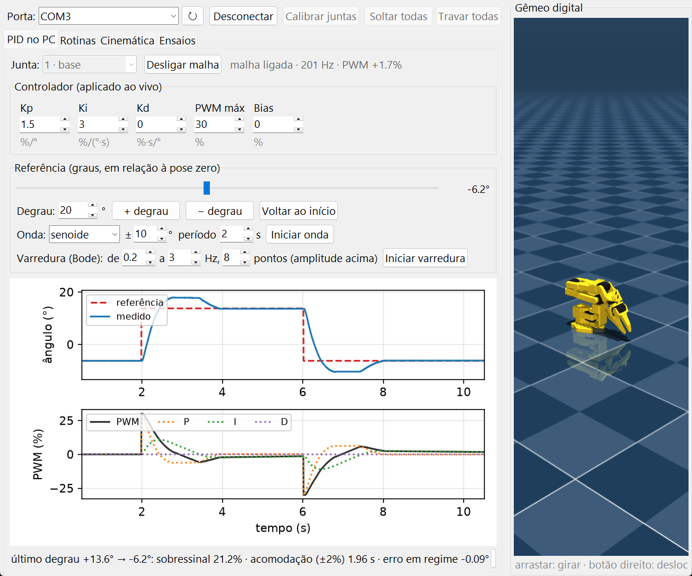

# Planta didática de controle PID com o braço SO-101

Material didático que acompanha o artigo *Planta didática de controle PID baseada
no braço robótico SO-101* (Trabalho de Conclusão de Curso, Engenharia Elétrica,
Multivix, 2026). Ele transforma o braço robótico aberto SO-101 numa planta de
controle: cada junta pode ser controlada por um PID executado no computador, com
gráficos em tempo real, ensaios automáticos e um gêmeo digital em 3D.

## Conteúdo

| Item | Onde |
|---|---|
| Programa **SO101-PID** para Windows | [Releases](../../releases) (arquivo `.zip`) |
| Cinco roteiros de prática, com notas e resultados de referência para o professor | [`roteiros/Roteiros_SO101-PID.pdf`](roteiros/Roteiros_SO101-PID.pdf) |
| Versão editável dos roteiros | [`roteiros/Roteiros_SO101-PID.docx`](roteiros/Roteiros_SO101-PID.docx) |

| Prática | Tema | Duração sugerida |
|---|---|---|
| 1 | Conhecendo a planta: malha aberta e atraso | 1 h 40 min |
| 2 | Efeito de P, I e D: atrito, *stick-slip* e saturação | 1 h 40 min |
| 3 | Identificação pela resposta em frequência e projeto do controlador | 2 aulas |
| 4 | Interação entre as juntas: gravidade e inércia | 1 h 40 min |
| 5 | Trajetórias e o controlador interno do servomotor como caixa-preta | 1 h 40 min |

As práticas 1 a 3 são indicadas para o nível técnico e para disciplinas
introdutórias; as práticas 3 a 5, para disciplinas de controle e robótica do nível
superior.

## Requisitos

- Computador com Windows 10 ou 11 (64 bits).
- Braço SO-101 (servomotores Feetech ST3215) com a placa controladora USB.
  **Sem o braço**, escolha *Simulador* na lista de portas: todas as práticas podem
  ser ensaiadas nele, com um modelo aproximado da planta medida no protótipo.

## Instalação

1. Baixe o `.zip` mais recente em [Releases](../../releases).
2. Extraia o arquivo inteiro numa pasta (não execute de dentro do `.zip`).
3. Abra `SO101-PID.exe`. Como o programa não é assinado digitalmente, o Windows
   pode exibir o aviso do SmartScreen: clique em *Mais informações* →
   *Executar assim mesmo*.
4. Ligue a fonte do braço, conecte o cabo USB, escolha a porta (ex.: `COM3`) e
   clique em **Conectar**. Se a porta não aparecer, instale o driver USB-serial
   da placa (WCH CH343).
5. Na primeira vez com o braço real, clique em **Calibrar juntas** e siga o
   assistente. A calibração fica salva na pasta do programa.

Em telas pequenas ou para projetar em sala, a interface pode ser ampliada
definindo a variável de ambiente `SO101_UI_SCALE` (por exemplo, `1.5`) antes de
abrir o programa.

## Segurança

- A parada de emergência é **desligar a fonte do braço**: mantenha a mão próxima
  ao interruptor sempre que a malha do computador estiver ligada.
- Mantenha livre o espaço de trabalho, nada ao alcance do braço esticado.
- Comece com os valores padrão (Kp = 1,5 %/°; PWM máximo = 30 %) e aumente os
  ganhos aos poucos. No ombro e no cotovelo, não ultrapasse degraus de ±20°.

Os roteiros trazem as orientações completas.

## Como citar

OLIVEIRA, G. L.; BARBOSA, M. V. F.; VOLKARTT, D. B. **Planta didática de controle
PID baseada no braço robótico SO-101**. 2026. Trabalho de Conclusão de Curso
(Engenharia Elétrica) – Multivix, Serra, 2026.

## Autores

Guilherme Lopes de Oliveira, Marcelo Victor Ferrari Barbosa e Deivid Bello
Volkartt. Orientador: prof. Matheus Rangel Pimentel.
